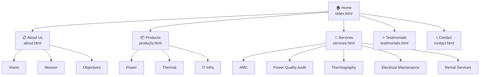

# HiPower Systems & Services — Full Website Rebuild

## Background

The current [hipower.in](https://hipower.in/) website is built on a GoDaddy template builder — it's functional but visually basic, with a minimalist white/grey theme, no navigation, and all content crammed onto a single long-scrolling page. It doesn't project the premium, enterprise-grade image that a 20-year ISO-certified power infrastructure company deserves.

We're rebuilding from scratch to create a **modern, premium, multi-page business website** that will attract enterprise clients in power, thermal, and IT infra management.

### Current Website Screenshots

````carousel

<!-- slide -->

<!-- slide -->

````

---

## User Review Required

> [!IMPORTANT]
> **Technology Choice**: I plan to use **Vite** as the build tool with vanilla **HTML, CSS, and JavaScript** (no React/Vue). This gives fast dev server, easy multi-page setup, and keeps the site lightweight. If you'd prefer React/Next.js instead, let me know.

> [!IMPORTANT]
> **Content**: I'll use the real company text from your existing site (About, Vision, Mission, etc.) and generate placeholder images for products/services using AI image generation. You'll need to replace these with actual product photos later.

> [!WARNING]
> **Customer Testimonials / Case Studies**: The current site has no testimonials. I'll create a testimonials page with **placeholder testimonial cards** — you'll need to provide real customer quotes and case study details to fill these in.

---

## Open Questions

1. **Logo**: Do you have a HiPower logo file (PNG/SVG) you can provide, or should I create a text-based logo?
2. **Brand Colors**: The current site uses a blue-grey accent (`#455A64`). I plan to elevate to a **dark navy + electric blue + warm gold** palette for a more premium feel. Are you open to this, or do you want to stay close to the current colors?
3. **Client Logos**: Should I include the client logo section (Tata, BIAL, ABB, GAIL, etc.) on the new site? If so, can you provide high-res logo files?
4. **Google Maps**: Do you want the embedded Google Map on the Contact page like the current site?

---

## Design Vision

### Color Palette
| Token | Color | Usage |
|-------|-------|-------|
| `--primary` | `#0A1628` | Dark navy background |
| `--primary-light` | `#132444` | Card backgrounds, sections |
| `--accent` | `#2563EB` | Electric blue — CTAs, links, highlights |
| `--accent-glow` | `#3B82F6` | Hover states, glows |
| `--gold` | `#F59E0B` | Premium accent — badges, ratings |
| `--text-primary` | `#F1F5F9` | Headings, primary text |
| `--text-secondary` | `#94A3B8` | Body text, descriptions |
| `--surface` | `#1E293B` | Card surfaces |
| `--border` | `rgba(255,255,255,0.08)` | Subtle borders |
| `--success` | `#10B981` | Success states |
| `--white` | `#FFFFFF` | Contrast elements |

### Typography
- **Headings**: `Inter` (Google Fonts) — bold, modern
- **Body**: `Inter` — clean, highly readable
- **Accent**: Monospace for stats/numbers

### Design Elements
- **Glassmorphism** cards with subtle backdrop blur
- **Gradient overlays** on hero images (dark navy → transparent)
- **Animated counters** for stats (20+ Years, 500+ Clients, etc.)
- **Smooth scroll** navigation with active section highlighting
- **Micro-animations** on hover (card lift, glow effects, icon transitions)
- **Particle/grid background** on hero for tech feel

---

## Proposed Changes

### Project Setup & Configuration

#### [NEW] [package.json](file:///c:/hipower/hipower-v0/package.json)
Vite project configuration with dev/build scripts.

#### [NEW] [vite.config.js](file:///c:/hipower/hipower-v0/vite.config.js)
Multi-page Vite configuration pointing to all HTML entry points.

#### [NEW] [.gitignore](file:///c:/hipower/hipower-v0/.gitignore)
Standard Node.js / Vite gitignore.

---

### Design System

#### [NEW] [src/css/variables.css](file:///c:/hipower/hipower-v0/src/css/variables.css)
CSS custom properties (design tokens): colors, typography, spacing, shadows, transitions.

#### [NEW] [src/css/reset.css](file:///c:/hipower/hipower-v0/src/css/reset.css)
Modern CSS reset (box-sizing, margin normalization, smooth scrolling).

#### [NEW] [src/css/base.css](file:///c:/hipower/hipower-v0/src/css/base.css)
Base typography, body styles, scrollbar styling, global utilities.

#### [NEW] [src/css/components.css](file:///c:/hipower/hipower-v0/src/css/components.css)
Reusable component styles: buttons, cards, badges, section headers, stat counters.

#### [NEW] [src/css/layout.css](file:///c:/hipower/hipower-v0/src/css/layout.css)
Grid system, containers, flex utilities, responsive breakpoints.

#### [NEW] [src/css/animations.css](file:///c:/hipower/hipower-v0/src/css/animations.css)
Keyframe animations: fade-in, slide-up, counter-increment, glow pulse, float.

---

### Pages (6 Total)

#### [NEW] [index.html](file:///c:/hipower/hipower-v0/index.html) — **Home Page**
The hero landing page. Sections:
1. **Hero**: Full-viewport with animated gradient overlay, company name, tagline "Powering India's Critical Infrastructure for 20+ Years", CTA buttons ("Explore Products" / "Contact Us")
2. **Stats Bar**: Animated counters — 20+ Years Experience, 500+ Clients, Pan-India Network, ISO Certified
3. **What We Do**: 3-column card grid (Power, Thermal, IT Infra) with icons and brief descriptions
4. **Why Choose Us**: USP section — ISO Certified, 20 Years Experience, Pan-India Service, 24/7 Support
5. **Trusted By**: Client logo carousel/grid (Tata, BIAL, ABB, GAIL, etc.)
6. **CTA Banner**: "Ready to Power Your Business?" with contact button

#### [NEW] [about.html](file:///c:/hipower/hipower-v0/about.html) — **About Us**
1. **Hero Banner**: "About HIPOWER" with gradient overlay
2. **Company Story**: Rich text about 20-year journey, ISO certification
3. **Vision**: Card with icon — "To be the most trusted partner..."
4. **Mission**: Card with icon — "Provide best-in-class solutions..."
5. **Objectives**: Card with icon — "Create support infrastructure..."
6. **Team/Values**: Grid showing core company values

#### [NEW] [products.html](file:///c:/hipower/hipower-v0/products.html) — **Products**
1. **Hero Banner**: "Our Products" with gradient overlay
2. **Product Category Cards** (3 main categories with expand/detail sections):
   - **Power**: UPS systems, voltage stabilizers, inverters. Image + detailed description + key specs
   - **Thermal**: Precision Air Conditioners (PAC), cooling solutions. Image + description
   - **IT Infra Management**: Server racks, cable management, monitoring. Image + description
3. **Partner Brands**: Vertiv partnership highlight
4. **CTA**: "Need a custom solution? Contact us"

#### [NEW] [services.html](file:///c:/hipower/hipower-v0/services.html) — **Services**
1. **Hero Banner**: "Our Services"
2. **Service Cards** (5 detailed service sections):
   - **AMC of UPS & Stabilizer**: Preventive maintenance, 24/7 support, spare parts
   - **Power Quality Audit**: Harmonic analysis, power factor measurement, load analysis
   - **Thermography**: IR scanning, predictive maintenance, electrical hotspot detection
   - **Electrical Maintenance**: Panel maintenance, earthing, safety audits
   - **Rental Services**: Temporary power solutions, UPS rental, DG rental
3. **Service Process**: Step-by-step visual (Consult → Assess → Deliver → Support)
4. **CTA**: "Schedule a Service" button

#### [NEW] [testimonials.html](file:///c:/hipower/hipower-v0/testimonials.html) — **Testimonials / Case Studies**
1. **Hero Banner**: "What Our Clients Say"
2. **Testimonial Cards**: Star ratings, client name, company, quote (placeholder data)
3. **Case Studies**: 2-3 detailed case study cards with:
   - Client industry, challenge, HiPower solution, outcome
   - Before/after metrics
4. **Client Logos**: Grid of trusted company logos

#### [NEW] [contact.html](file:///c:/hipower/hipower-v0/contact.html) — **Contact Us**
1. **Hero Banner**: "Get In Touch"
2. **Contact Form**: Name, Email, Phone, Company, Message, Submit
3. **Contact Info Cards**: Phone, Email, Address, WhatsApp
4. **Google Map Embed**: Peenya office location
5. **WhatsApp CTA**: Floating WhatsApp button

---

### JavaScript

#### [NEW] [src/js/main.js](file:///c:/hipower/hipower-v0/src/js/main.js)
Core JS: mobile nav toggle, smooth scroll, scroll animations (IntersectionObserver), active nav highlighting, animated counters.

#### [NEW] [src/js/navbar.js](file:///c:/hipower/hipower-v0/src/js/navbar.js)
Sticky navbar behavior: transparent on top, solid on scroll, mobile hamburger menu.

#### [NEW] [src/js/animations.js](file:///c:/hipower/hipower-v0/src/js/animations.js)
Scroll-triggered reveal animations using IntersectionObserver. Counter animation logic.

#### [NEW] [src/js/contact-form.js](file:///c:/hipower/hipower-v0/src/js/contact-form.js)
Contact form validation and WhatsApp integration (open WhatsApp with pre-filled message).

---

### Assets

#### [NEW] [public/images/](file:///c:/hipower/hipower-v0/public/images/)
Generated AI images for:
- Hero backgrounds (power infrastructure, data center)
- Product category images (UPS systems, cooling units, server racks)
- Service illustrations
- Team/about imagery

#### [NEW] [public/favicon.ico](file:///c:/hipower/hipower-v0/public/favicon.ico)
HiPower favicon.

---

## Site Architecture



## Navigation Structure

```
┌───────────────────────────────────────────────────┐
│ HIPOWER Logo    Home  About  Products  Services   │
│                 Testimonials  Contact      [CTA]  │
└───────────────────────────────────────────────────┘
```

Every page includes:
- **Sticky Navbar** with logo + links + "Get a Quote" CTA button
- **Footer** with contact info, quick links, social links, copyright

---

## Verification Plan

### Dev Server
- Run `npm run dev` to verify all pages load correctly
- Test navigation between all 6 pages
- Verify responsive design at mobile (375px), tablet (768px), and desktop (1440px) breakpoints

### Visual QA
- Review each page in the browser for design consistency
- Verify animations and hover effects work smoothly
- Check all links point to correct pages

### Build Test
- Run `npm run build` to verify production build succeeds
- Serve the `dist/` folder to verify production output

### Cross-Browser
- Test in Chrome (primary) — user can verify Edge/Firefox separately
